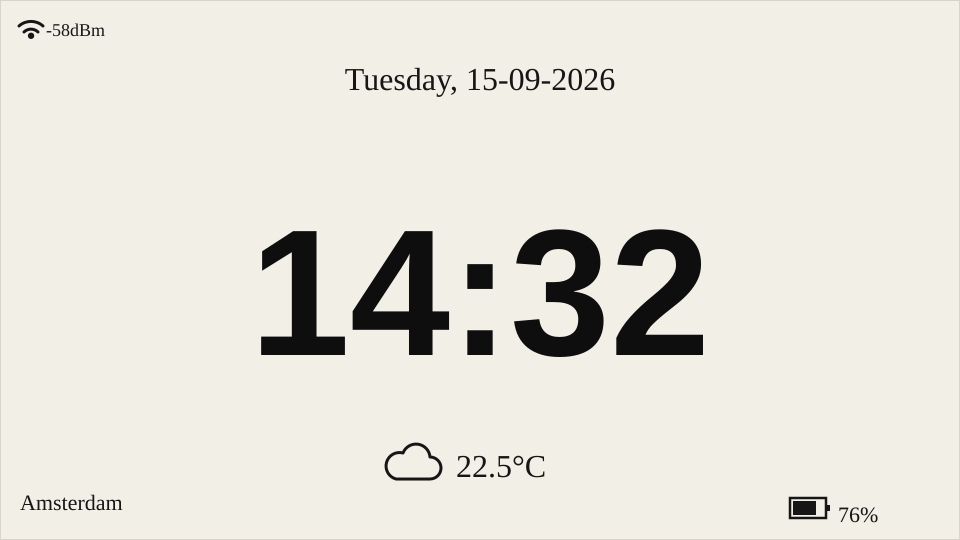

# paperclock-rs

E-paper desk clock firmware for the [M5Stack PaperS3](https://docs.m5stack.com/en/core/papers3), written in Rust. Shows time, date, weather, WiFi signal and battery, and updates once a minute.



*(Mockup - looks slightly different when rendered on device)*

## Hardware

- M5Stack PaperS3 (ESP32-S3R8, 960x540 ED047TC1 panel, driven via [epdiy](https://github.com/vroland/epdiy))
- BM8563 RTC over I2C (G41/G42)
- SD card over SPI (CS=G47, SCK=G39, MOSI=G38, MISO=G40)
- Battery voltage on GPIO3 via a 2:1 divider
- Charge status on GPIO4 (`CHG_STAT`, active-low)

## Setup

Put a `wifi_config.json` in the root of a FAT-formatted SD card:

```json
{
  "ssid": "your-network-name",
  "password": "your-network-password",
  "lat": 52.37,
  "lon": 4.89,
  "city": "Amsterdam"
}
```

`lat`, `lon` and `city` are optional; without them the location is looked up by IP on first connect. Insert the card and power on the board.

## Toolchain

Everything lives in `.toolchain/` inside the project rather than being installed system-wide, so nothing here touches a global Rust or Python install. `env.ps1` points `RUSTUP_HOME`, `CARGO_HOME`, `PATH` and the ESP-IDF variables at it, and has to be sourced before any cargo or espflash command.

The build is Windows/PowerShell only as written, and needs long-path support enabled - the ESP-IDF build nests paths deeply enough to hit the 260-character limit otherwise:

```powershell
# as administrator, once
Set-ItemProperty -Path "HKLM:\SYSTEM\CurrentControlSet\Control\FileSystem" `
  -Name LongPathsEnabled -Value 1
```

To set the toolchain up from scratch:

```powershell
# Python 3.9+ (ESP-IDF requires it) into .toolchain/python, if the system
# Python is older. Only needed to regenerate fonts.
.\.toolchain\python\python.exe -m pip install freetype-py fonttools

. .\env.ps1

# Rust, the xtensa toolchain, and the flashing tools
rustup toolchain install stable
cargo install espup espflash ldproxy
espup install --export-file .toolchain\export-esp.ps1
```

`espup install` writes `export-esp.ps1`, which `env.ps1` sources to pick up `LIBCLANG_PATH` and the xtensa GCC path. ESP-IDF itself is cloned automatically on the first build, into `.build/` - expect that build to take 10-20 minutes.

If you already have an esp-rs setup and would rather use it, you can skip `env.ps1` entirely: source your own `export-esp.ps1` and run `cargo build --release` in `firmware/`. Everything the build needs to be correct is in `firmware/.cargo/config.toml`; `env.ps1` only pins the toolchain and build output to this folder.

## Building and flashing

```powershell
. .\env.ps1
cd firmware
cargo build --release
```

Or use the wrappers in `scripts/`, which source `env.ps1` for you:

```powershell
.\scripts\build.ps1
.\scripts\flash.ps1
```

`flash.ps1` flashes and monitors in one step, because running them separately loses the boot log - the board's USB re-enumerates on reset.

## How it works

The board deep-sleeps between updates and wakes once a minute, aligning each wake to the next real minute boundary using the RTC's seconds register. It stays awake instead of sleeping while charging.

Most wakes do a non-flashing partial refresh; a full flashing refresh runs on the hour to clear e-ink ghosting. Deep sleep wipes PSRAM, where epdiy keeps its record of what's currently on the panel, so before each partial refresh the previous frame is redrawn into that buffer from values kept in RTC memory. See `RefreshMode` in `display.rs`.

Weather refreshes about every 10 minutes, NTP and geolocation about every hour (`WEATHER_REFRESH_EVERY_N_WAKES` and `NETWORK_REFRESH_EVERY_N_WAKES` in `main.rs`).

## Layout

```
firmware/src/
  main.rs      wake handling, refresh cadence, frame layout
  display.rs   epdiy wrapper: fonts, drawing, refresh modes
  cache.rs     RTC-memory persistence across deep sleep
  battery.rs   ADC voltage read, percentage, usage tracking
  wifi.rs      WiFi connect/scan
  sd.rs        SD card config reader
  ntp.rs       NTP sync to RTC
  weather.rs   Open-Meteo client
  geoip.rs     IP geolocation
  sleep.rs     deep sleep and wake-cause helpers
  watchdog.rs  task watchdog
firmware/components/
  epdiy        vendored display driver (C), patched for ESP-IDF v5.5.3
  fonts        generated bitmap fonts
scripts/       PowerShell build/flash/clean wrappers
```

## Fonts

Inter for the clock (its digits are tabular, which matters at that size), Literata for everything else, plus Font Awesome and [Weather Icons](https://erikflowers.github.io/weather-icons/) for the icons. All SIL Open Font License. Variable fonts are instanced to static weights with `fontTools`, then rasterized with epdiy's `fontconvert.py`.
